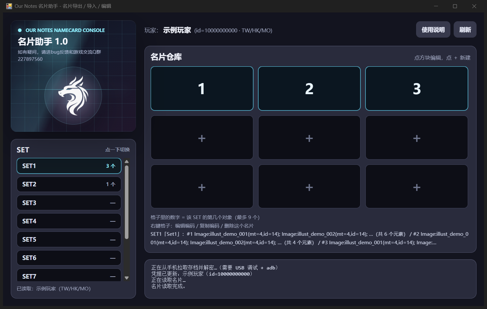

# 《BanG Dream! Our Notes》名片助手

> **第一个用游戏自己的协议读写名片的工具。**
> 不点屏幕、不截图、不 OCR、不用模拟器。

[English](README.md) · [技术细节](docs/how-it-works.zh-CN.md) · [常见问题](docs/faq.zh-CN.md) · [免责声明](docs/disclaimer.zh-CN.md)



> **v1.0.1 —— 2026-10-20。** Windows 10/11 x64 + 安卓手机（USB 线）。
> 一个 36 MB 的 exe，解压即用，不用装 Python。
> → **[下载](https://github.com/YKLovePython/ournotes-namecard/releases/latest)**

---

## 这是这个游戏里的「第一次」

**2026-10-20。** 在这一天，我们找不到任何公开的《BanG Dream! Our Notes》
名片（プロフィールカード）读写工具。围绕着这个游戏的开源项目是存档解密、
API 代理、master data、粉丝数据库、自动演奏 —— **没有一个能读写名片。**

在这个项目之前，下面这些事都不存在：

| | 以前 | 现在 |
| --- | --- | --- |
| 改名片 | 在游戏里一格一格拖 | **直接调游戏自己的 gRPC 接口** |
| 把名片搬到另一个号 | 每个图章重摆一遍 | **贴一行字** |
| 名片「分享码」 | 没有 | `OURNOTES-CARD-v1:…`，**逐字节无损** |
| 跨区服 | 没有 | 自动识别 港台 / EN / 韩服 |
| 写入路径的说明文档 | 没有 | [`docs/how-it-works.zh-CN.md`](docs/how-it-works.zh-CN.md) |

对玩家社区来说，这件事的意义在于：**名片从一张截图，变成了数据。**
它可以被复制、被交换、被重新排版、被存档、被对比 ——
一张名片不再绑死在做出它的那个账号上。一个本来就是为了「给别人看」而存在
的系统，第一次真的可以被玩家自己搬来搬去。

**两件事分开说清楚：**

1. **时间** —— 2026-10-20，封存的源码包和这一版发布包同时写进了
   **比特币（OpenTimestamps）**、并由 **FreeTSA 签发 RFC 3161 时间戳**。
   这证明「这一天它已经存在」，见 [`proof/`](proof/README.md)。
2. **首创** —— 我们在这一天做了检索，没找到同类工具。这是**检索结论**，
   不是数学证明。如果你知道更早的实现，把链接发给我们，我们补进「先行工作」。

---

## 它能做什么

一个账号有 **10 个名片槽位 × 每个 9 个对象 = 90 个名片对象**。工具按游戏里的样子展示：

* **左边** —— SET1…SET10，点一下切换；
* **右边** —— 当前 SET 的 3×3 仓库；
* 数字 = 已有的名片对象，**＋** = 空位；
* 点数字编辑**分享码**，右键 = 编辑编码 / 复制编码 / 删除这个名片；
* **刷新** —— 先从手机拉最新凭据（插着 USB 时），再读回名片。

每一次写入都要**连点三次确认**；命令行有 `--dry-run`。只读操作永远不会写数据。

### 分享码

一个名片对象本身就是一段 JSON。分享码就是这段 JSON，也可以压成一行：

```
OURNOTES-CARD-v1:<base64url(zlib(json))>
```

关键设计：**分享码里存的是 master id，不是渲染出来的文字**。
所以没有 OCR、没有简繁日歧义、不依赖字体。只有玩家名是自由文本。
把 body 用 `json.dumps(separators=(",", ":"))` 序列化回去，和游戏自己存的
字符串**逐字节一致**（已用往返测试验证）。

---

## 使用条件

| | |
| --- | --- |
| 系统 | Windows 10 / 11 x64（需要 WebView2，Edge 自带） |
| 手机 | 安卓，打开 **USB 调试**，用线连着 |
| 游戏 | 《BanG Dream! Our Notes》港台 / EN / 韩服 |

macOS、Linux、iOS **不支持**，也没测试过。

## 用法

1. 到 [Releases](https://github.com/YKLovePython/ournotes-namecard/releases/latest)
   下载 zip，解压后**只有一个文件** `OurNotes名片助手.exe`。
   别放进 `C:\Program Files`（它会在自己旁边写文件）。
2. 手机上先把游戏**完全退出**。
3. 插线，手机弹「允许 USB 调试」时勾「始终允许」。
4. 双击 exe → 点右上角 **刷新**。首次启动要 2~5 秒。
5. 左边选 SET，点方块编辑，**确认更改** 连点 3 次即写入游戏。

## 校验下载

```powershell
certutil -hashfile OurNotes名片助手-v1.0.1.zip SHA256
```

应当等于

```
094f681f455c3e4a3d9c252d712a358b8e17bbe193ba887745143ba1caf797c7
```

然后再按 [`proof/README.md`](proof/README.md) 验证时间戳。

---

## 为什么这件事需要逆向

游戏客户端是 HTTP/2 + gRPC，没有公开接口，也没开 reflection。几个关键点：

**1. 名片本来就在玩家数据里。**
`GetPlayerData` 一次返回约 63 KB 的玩家状态，字段 51 就是名片槽位。
所以「读」只要一次带鉴权的调用 —— 不用抓屏、不用识别。

**2. 「写」是 5 个小 RPC，不是 UI 自动化。**
`SaveProfileCard` / `RemoveProfileCard` / `EditProfileCardSlot` /
`SettingProfileCard` / `PutObjects`。请求体是手搓的 protobuf
（保存一个对象是 `{1: 槽位, 2: 序号, 3: body}`）。因为写入是**一次服务器调用**，
在游戏看来是原子的：要么新内容在，要么不在，不会出现拖到一半的残局。

**3. 凭据在手机存档里，而且会轮换。**
工具通过 adb 拉存档、解密（Rijndael-256-CBC + PKCS7，前面 64 字节自定义头，
然后是 gzip + JSON），取出 `_certification._playerId` 和
`_certification._authorizationKey`。游戏每次重新登录都会换 key，所以
**刷新**时会重新拉一次。报 `TOKEN_ILLEGAL` 几乎都是这个原因。

**4. 三个区服，玩家不互通。**
匿名的 `GetServerList` 会列出港台 / EN / 韩服三套不同的 API 节点。
拿港台服的凭据去问 EN 服，服务器会回 **`PLAYER_NOT_EXISTS`**（查无此人）——
看着像「凭据坏了」，其实不是。工具会挨个区服试一次，按账号记住结果；
之后再遇到「查无此人」会自动重探。

完整的数据模型、字段布局、鉴权头、踩过的坑：
[`docs/how-it-works.zh-CN.md`](docs/how-it-works.zh-CN.md)。

---

## 时间存证

| 是什么 | 在哪 |
| --- | --- |
| RFC 3161 可信时间戳（FreeTSA） | `proof/OurNotes名片助手-v1.0.1.zip.tsr` |
| 比特币时间戳（OpenTimestamps） | `proof/OurNotes名片助手-v1.0.1.zip.ots` |
| 封存的源码包（**不公开**，只公开哈希） | `proof/archive-sha256.txt` |
| 验证方法 | [`proof/README.md`](proof/README.md) |

两个互相独立的时间源：一个有 CA 链的权威机构（秒级出证），一个是谁都撤不回的
比特币（等区块）。任意一个成立，时间就成立；两个都不需要相信作者或 GitHub。

---

## 先行工作

写之前我们查过，2026-10-20 又查了一次。围绕《Our Notes》的公开项目：

| 项目 | 是什么 | 能读写名片吗 |
| --- | --- | --- |
| `MetaSekaiLab/nnnotes` | 存档解密 + master data 工具 | 不能 |
| `Srirus-Project/sirius-api-proxy` | 非官方 API 代理（Rust）。它带 `entity/profilecard.proto`（**数据结构**），但注册的服务只有 announcement / event / friend / livemusic / masterdata / player | **不能**（只有结构定义） |
| `bandori-sirius/master-db-en` / `-kr` | master data 转储 | 不能 |
| `AwadoriProj/private-notes`、`aircookieee/Cone` | 私服 / 逆向工具 | 不能 |
| `elfi00zt/OurNotesDataBase`、`leonorexyz/OurNotes` | 粉丝数据库、攻略站 | 不能 |
| 谱面库 / 自动演奏项目 | 谱面与打歌 | 不能 |
| **本项目** | 读写名片、分享码、区服自动识别 | **能** |

检索记录 —— **2026-10-20**，GitHub 仓库搜索，每一条都是 **0 结果**：

```
ournotes namecard        → 0        bandori namecard        → 0
ournotes profilecard     → 0        "profile card" bandori  → 0
"our notes" namecard     → 0        sirius namecard         → 0
```

**该给的功劳要给。** `sirius-api-proxy` 里的 `entity/profilecard.proto`
独立记录出了和本工具逆向结果**完全一致**的字段布局
（`slot=1, name=2, is_setting=3, profile_objects=4`；
`index=1, profile_object_json=2, thumbnail_url=3, disp_order=4`）。
两条互不相干的路径得出同一个结论，对双方都是好事 ——
也正因如此，我们主张的是**工具**，不是数据结构。

如果存在更早的、真能在玩家之间搬运名片的实现，告诉我们，我们补到这里。

---

## 安全

* 只动**你自己的**账号，而且写入前要三次确认。
* 写入限速（每 0.8 秒一次）—— 短时间内大量写会被服务器 GOAWAY 掉线。
* **别和游戏同时用**：会话可能互相挤掉。
* 导入后名片的缩略图 URL 会短暂指向原始数据；游戏客户端下次同步 / 保存时会
  自动重画成正式 PNG。名片本体（`body`）不受影响。
* 凭据不出本机：`cred.json` 就在 exe 旁边，已在 `.gitignore`。
  **别把它发给任何人** —— 那是一把活的账号钥匙。

## 作者与社区

* B站 **作业快没了**
* Q 群 **227897560** —— 问题、bug、换名片都在这
* 反馈：[Issues](https://github.com/YKLovePython/ournotes-namecard/issues)

## 致谢

存档解密用的是 `nnnotes`（MetaSekaiLab）；界面用 `pywebview` + WebView2。
外观风格来自我们的另一个工具「谛听 1.0」。

---

## 免责声明

本项目用于**研究与学习**：游戏协议分析、无 .proto 的 protobuf、桌面端 UI 工程。
与游戏发行方无关。

工具会真的改动账号数据；自动化线上游戏可能违反服务条款。
请只在**你愿意失去**的账号上使用，不要用于排名，不要商用。
详见 [`docs/disclaimer.zh-CN.md`](docs/disclaimer.zh-CN.md)。

## 许可

文档、文字、截图：**CC BY-NC-SA 4.0**。
**实现（源码）不在本仓库里**，也不授权再分发。本仓库只有文档和成品下载。

---

<details>
<summary>搜索关键词</summary>

BanG Dream Our Notes 名片 · バンドリ プロフィールカード · 名片导出导入 ·
个人名片 分享码 · 名片助手 · Our Notes 名片工具 · profile card export import ·
profile card share code · 游戏协议逆向 · gRPC protobuf 无 schema ·
音游 名片 交换 · namecard editor · Android 存档解密 · 10 槽位 9 对象

</details>
